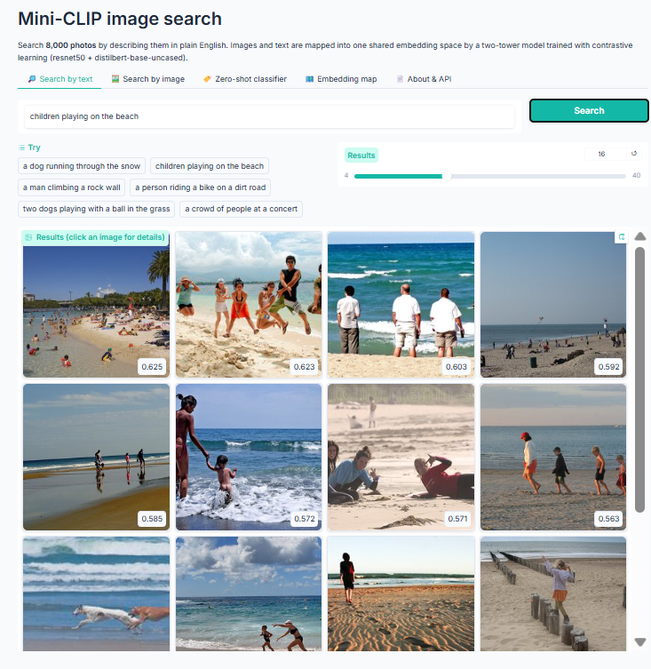
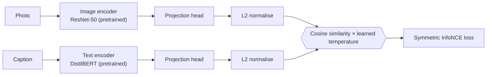
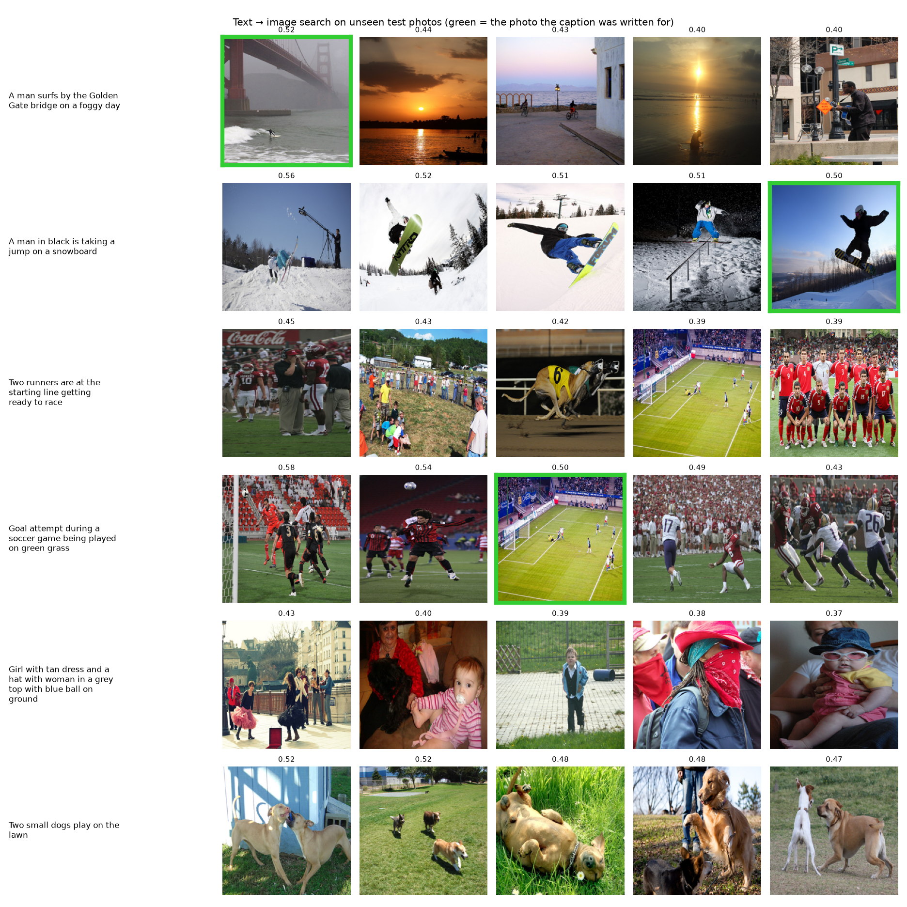
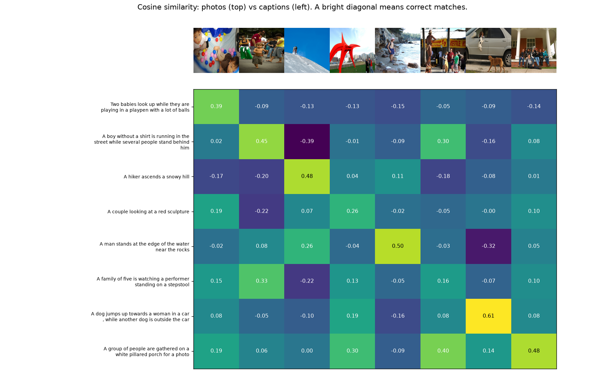
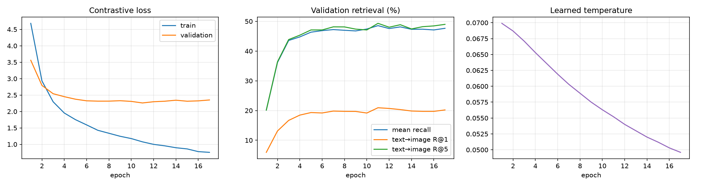
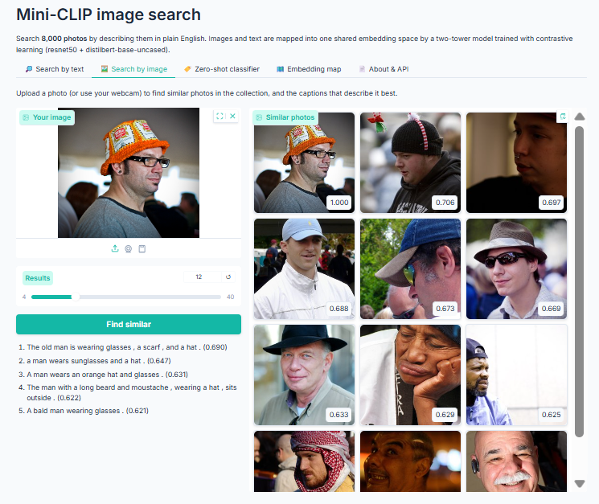
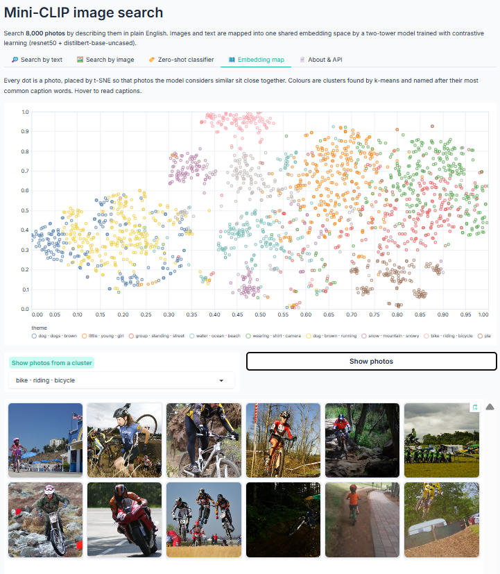

# Mini-CLIP: Image Search with Contrastive Learning

[](https://github.com/Sidrashabir/mini-clip/actions)


[](https://sidrashabir.github.io/mini-clip/)

A CLIP-style vision-language model that maps photos and text into one shared embedding space, trained with contrastive learning on Flickr8k and built into a search engine with a web app and REST API. Type *"a dog jumping into a lake"* and it finds matching photos it has never seen labelled, without any tags or keywords.

**[▶ Try the live demo](https://sidrashabir.github.io/mini-clip/)**: it runs entirely in your browser, with no server, so the link always works.



---

## Highlights

- **Two-tower architecture:** a pretrained ResNet-50 image encoder and a pretrained DistilBERT text encoder, joined by trainable projection heads into a shared 256-dimensional space.
- **Contrastive training:** symmetric InfoNCE loss with a learnable temperature, as in OpenAI's CLIP, plus a label-aware variant that never treats two captions of the same photo as a negative pair.
- **Two training modes:** *frozen* mode caches backbone features once so training runs in minutes on a laptop CPU; *fine-tune* mode unfreezes the top layers of both backbones with differential learning rates and mixed precision on a GPU.
- **Rigorous evaluation:** Recall@1/5/10 and median rank in both directions on 1,000 held-out photos and 5,000 captions.
- **Explainability:** occlusion analysis shows which words of a query and which regions of a photo drove each match.
- **Full product:** text search, image search, caption retrieval, zero-shot classification and an interactive embedding map, served as a web app and a documented REST API, with automated tests on every push.
- **Serverless live demo:** the trained text tower runs in the visitor's browser (DistilBERT via transformers.js plus the projection head in plain JavaScript), hosted for free on GitHub Pages and checked against the Python model on every page load.
- **Search your own photos:** index any folder on your computer and search it in plain English.

---

## How it works



During training, each batch contains *N* photos and one caption for each. The model computes an *N × N* similarity matrix and is trained so that every photo picks out its own caption among all *N*, and every caption picks out its own photo. This pulls matching pairs together in the embedding space and pushes everything else apart, without ever being told what objects are in the photos.

At search time, every photo in the collection is embedded once. A text query is embedded with the text tower and compared against all photo embeddings by cosine similarity, using a FAISS inner-product index.

| Component | Implementation |
|---|---|
| Image encoder | `timm` ResNet-50, ImageNet-pretrained, global average pooled (2,048-d) |
| Text encoder | DistilBERT with attention-masked mean pooling (768-d) |
| Projection heads | linear projection + residual GELU MLP + LayerNorm → 256-d |
| Loss | symmetric cross-entropy over the similarity matrix (InfoNCE), temperature learned and capped at 1/100 |
| Optimisation | AdamW, warmup + cosine schedule, gradient clipping, early stopping on validation recall |
| Regularisation | augmented feature views (random crops, flips, colour jitter) in frozen mode; dropout in heads |
| Search | FAISS `IndexFlatIP` over normalised embeddings, with an exact NumPy fallback |

---

## Results

Evaluated on the official Flickr8k test split: 1,000 photos and 5,000 captions never seen during training. Recall@K is the percentage of queries whose correct match appears in the top K results.

| Model | Trained on | Text→Image R@1 | R@5 | R@10 | Image→Text R@1 | R@5 | R@10 |
|---|---|---|---|---|---|---|---|
| Mini-CLIP (frozen backbones) | 6k images | **19.7** | **47.1** | **61.8** | **25.9** | **55.0** | **68.4** |
| Random guessing | – | 0.1 | 0.5 | 1.0 | 0.1 | 0.5 | 1.0 |

| Metric | Value |
|---|---|
| Mean recall (all six scores) | 46.3 |
| Median rank, text → image | 6th of 1,000 photos |
| Median rank, image → text | 4th of 5,000 captions |
| Trained parameters | 0.85M (projection heads only) of 90.7M |
| Learned temperature | 0.0552 |

For a typical caption, the photo it was written for appears around 6th out of 1,000, and in the top 10 for 62% of captions, against 1% for random guessing. This comes from training only the two projection heads (0.85M parameters) on 6,000 photos, on a laptop CPU.

### Retrieval examples



Each row is a caption from the test set and the five photos the model ranked highest. The green border marks the photo the caption was originally written for. Where it is missing, the results are still often valid matches, such as other snowboarders, soccer games or pairs of dogs playing on grass, which Recall@K does not reward.

### Similarity matrix



Cosine similarity between eight test photos and their captions. The bright diagonal shows that seven of the eight captions are most similar to their own photo. The exception is *"A family of five is watching a performer"*, which scores higher with a similar outdoor street crowd.

### Training



Validation recall rises quickly and levels off after about seven epochs, while training loss keeps falling: with only 6,000 photos, the heads begin to fit the training set more than they generalise. Early stopping keeps the best checkpoint (epoch 11) and ends training when validation recall stops improving. The learned temperature falls steadily as the model grows more confident, sharpening the similarity distribution.

---

## Web application

| Tab | What it does |
|---|---|
| **Search by text** | Ranked photo results for any description. Selecting a result shows its human-written captions and an explanation of the match |
| **Search by image** | Upload a photo or use a webcam to find similar photos and the captions that describe it best |
| **Zero-shot classifier** | Classify a photo into any labels you type, by comparing it with sentences such as *"a photo of a dog"* |
| **Embedding map** | A t-SNE map of the collection, clustered with k-means and labelled by each cluster's most distinctive caption words |
| **About & API** | Model card, evaluation results and API examples |

### Search by image



The uploaded photo's closest neighbours are other close-up portraits of men in hats, and the captions the model picks for it (*"A man wears an orange hat and glasses"*) describe it well, although the model never saw this kind of query during training.

### Embedding map



The t-SNE map groups the collection into themes the model discovered on its own, such as *dog · dogs · brown*, *water · ocean · beach*, *snow · mountain · snowy* and *bike · riding · bicycle*, shown here with sample photos from the bike cluster.

Selecting a search result also explains the match: each word of the query, and each cell of a 7 × 7 grid over the photo, is hidden in turn to measure how much the similarity drops.

### Live demo

The [live demo](https://sidrashabir.github.io/mini-clip/) is a static version of the app for the 1,000 unseen test photos: text search, word-level explanations, zero-shot labels, caption retrieval, similar photos and the embedding map. When it opens, the browser downloads DistilBERT (an ONNX copy of the same pretrained weights, about 70 MB, cached after the first visit) and the trained projection head, then embeds each query locally and compares it with photo embeddings computed in advance by the trained image tower. On load, it embeds three reference sentences and confirms they match the Python model's embeddings. Uploading your own photos and image-region explanations need the image tower, so they are available in the local app.

### REST API

Interactive documentation is served at `/docs`.

| Method | Endpoint | Description |
|---|---|---|
| GET | `/api/health` | Health check |
| GET | `/api/model` | Model details and metrics |
| POST | `/api/search/text` | Text → ranked photos |
| POST | `/api/search/image` | Uploaded photo → similar photos |
| POST | `/api/describe` | Uploaded photo → best-matching captions |
| POST | `/api/classify` | Uploaded photo + labels → zero-shot probabilities |
| POST | `/api/explain` | Word and region importance for a match |
| GET | `/api/images/{file}` | Gallery thumbnail |

```bash
curl -X POST http://localhost:7860/api/search/text \
  -H "Content-Type: application/json" -d '{"query": "a dog jumping into a lake", "k": 5}'

curl -X POST http://localhost:7860/api/classify -F "file=@photo.jpg" -F "labels=dog, cat, horse"
```

---

## Getting started

Requirements: Python 3.10 or newer and about 3 GB of free disk space. Developed in VS Code on Windows; works on macOS and Linux. No GPU needed.

### 1. Install

```bash
git clone https://github.com/Sidrashabir/mini-clip.git
cd mini-clip

python -m venv .venv
.venv\Scripts\activate          # Windows
# source .venv/bin/activate     # macOS / Linux

pip install -r requirements.txt
python -m pytest tests -v       # 21 tests, fully offline
```

### 2. Train

```bash
python prepare.py               # download Flickr8k (8,000 photos, 5 captions each, ~1.1 GB)
python train.py                 # frozen backbones on CPU
```

| Step | Time on a laptop CPU | When |
|---|---|---|
| Download ResNet-50 and DistilBERT | 1–3 min | first run only |
| Extract features for 7,000 photos and 35,000 captions | 10–25 min | first run only, cached in `cache/` |
| Train the projection heads | 1–3 min | every run |

Because features are cached, re-training with other settings takes a couple of minutes, for example `python train.py --embed_dim 512`. `python train.py --aug_views 2` adds two augmented views of each training photo for better results (the first run takes about three times longer). With a GPU, `python train.py --preset gpu` fine-tunes the top layers of both encoders instead.

### 3. Evaluate and create the figures

```bash
python evaluate.py --run runs/flickr8k_cpu --compare_clip openai/clip-vit-base-patch32
python visualize.py --run runs/flickr8k_cpu
```

`--compare_clip` downloads OpenAI's CLIP (about 600 MB) for the comparison; leave it out to skip it.

### 4. Run the app

```bash
python export.py --run runs/flickr8k_cpu      # model + searchable gallery of all 8,000 photos (10–20 min)
python server.py
```

Open **http://localhost:7860** for the app and **http://localhost:7860/docs** for the API. Use `--gallery test` with `export.py` for a faster gallery of only the 1,000 unseen test photos.

### 5. Publish the live demo

```bash
python export_web.py --run runs/flickr8k_cpu      # writes the demo's data into docs/ (about 17 MB)
python -m http.server --directory docs            # optional preview at http://localhost:8000
```

Push to GitHub, then in the repository open **Settings → Pages**, set **Source** to *Deploy from a branch*, choose branch **main** and folder **/docs**, and save. After a minute or two, the demo is live at `https://sidrashabir.github.io/mini-clip/`. It is a static site, so it never sleeps and costs nothing. Re-run `export_web.py` and push again whenever you retrain.

The live demo needs the default frozen training mode, since it uses the stock pretrained DistilBERT in the browser.

### Search your own photos

```bash
python gallery.py --images "C:\Users\you\Pictures\Trip" --out my_gallery
python server.py --gallery my_gallery
```

Everything runs locally; no photos leave your computer.

### Train on your own image-caption data

Provide a CSV with `image` and `caption` columns, then:

```bash
python prepare.py --dataset csv --csv captions.csv --images path/to/images --name mydata
python train.py --data data/mydata
```

### Troubleshooting

| Problem | Fix |
|---|---|
| `No space left on device` during `prepare.py` | Free about 3 GB and run it again; it resumes and repairs incomplete files |
| `faiss-cpu` fails to install | Remove it from `requirements.txt`; search falls back to NumPy automatically |
| Feature extraction is very slow | Plug in the charger, set Windows power mode to Best performance, close other heavy programs |
| `No model in 'model'` | Run `export.py` before `server.py` |
| Page doesn't open at `0.0.0.0:7860` | Use `http://localhost:7860` instead |

---

## Project structure

```
mini-clip/
├── encoders.py         # image (timm) and text (Hugging Face) encoders
├── model.py            # projection heads, contrastive loss, retrieval metrics, checkpoint loading
├── data.py             # dataset format, loaders and one-time feature caching
├── prepare.py          # Flickr8k download, custom CSV datasets, synthetic test data
├── train.py            # frozen and fine-tune training
├── evaluate.py         # test-set evaluation and CLIP comparison
├── visualize.py        # README figures
├── gallery.py          # searchable galleries: thumbnails, embeddings, map, clusters; index your own photos
├── export.py           # package a trained model with its gallery for the local app
├── export_web.py       # export the live demo website into docs/
├── docs/index.html     # the live demo (runs the model in the browser; GitHub Pages)
├── inference.py        # search, classification and explanation engine
├── api.py              # REST API
├── app.py              # web interface
├── server.py           # application entry point
├── tests/              # loss, metrics, model and end-to-end pipeline tests
└── .github/workflows/ci.yml
```

### Testing

The test suite checks the contrastive loss against hand-computed values (including the label-aware variant), retrieval metrics against known rankings, that raw-input and cached-feature training paths agree, and that padding never affects text embeddings. An end-to-end test builds a synthetic dataset, trains in both modes, exports a gallery, exercises every search feature and API endpoint, including input validation and path-traversal protection, and checks the live demo export. Tests use small offline encoders, so they run in about 30 seconds without downloads. GitHub Actions runs linting and the full test suite on every push.

---

## Future work

- Hard-negative mining to sharpen fine-grained distinctions such as colours and counts
- Fine-tuning on the larger Flickr30k and MS-COCO caption datasets
- Approximate nearest-neighbour indexes (IVF, HNSW) for million-image collections
- Multilingual search with a multilingual text encoder

---

## References

1. Radford, A., et al. (2021). *Learning Transferable Visual Models From Natural Language Supervision.* ICML.
2. van den Oord, A., Li, Y., & Vinyals, O. (2018). *Representation Learning with Contrastive Predictive Coding.* arXiv:1807.03748.
3. Hodosh, M., Young, P., & Hockenmaier, J. (2013). *Framing Image Description as a Ranking Task: Data, Models and Evaluation Metrics.* Journal of Artificial Intelligence Research, 47.
4. He, K., Zhang, X., Ren, S., & Sun, J. (2016). *Deep Residual Learning for Image Recognition.* CVPR.
5. Sanh, V., Debut, L., Chaumond, J., & Wolf, T. (2019). *DistilBERT, a distilled version of BERT: smaller, faster, cheaper and lighter.* arXiv:1910.01108.
6. Chen, T., Kornblith, S., Norouzi, M., & Hinton, G. (2020). *A Simple Framework for Contrastive Learning of Visual Representations.* ICML.
7. Johnson, J., Douze, M., & Jégou, H. (2019). *Billion-scale similarity search with GPUs.* IEEE Transactions on Big Data.
8. van der Maaten, L., & Hinton, G. (2008). *Visualizing Data using t-SNE.* Journal of Machine Learning Research, 9.
9. Zeiler, M. D., & Fergus, R. (2014). *Visualizing and Understanding Convolutional Networks.* ECCV.
10. Wightman, R. *PyTorch Image Models (timm).* github.com/huggingface/pytorch-image-models.
11. Wolf, T., et al. (2020). *Transformers: State-of-the-Art Natural Language Processing.* EMNLP: System Demonstrations.

---

## License

Released under the MIT License.
